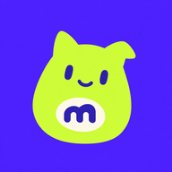
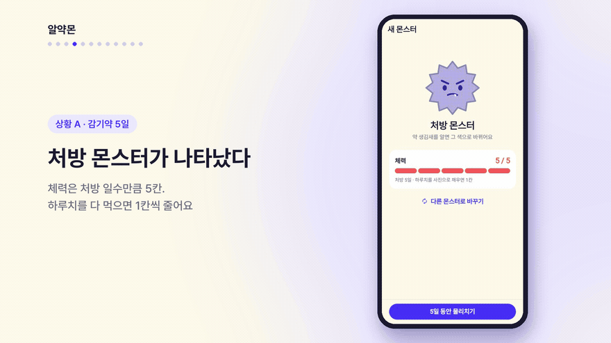
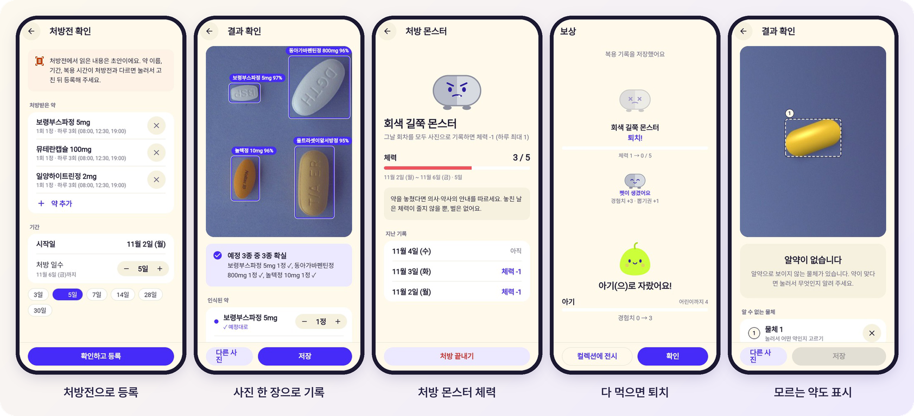

<div align="center">



# 알약몬

**알약 사진 한 장으로 남기는 복용 기록**<br>
찍고, 확인하고, 저장하면 끝. 기록할수록 내 캐릭터가 자라요.

[](https://www.havepills.party)


<a href="docs/media/demo.mp4"></a>

▶ [전체 데모 영상 보기 (2분, BGM 포함)](docs/media/demo.mp4)

</div>

## 이런 앱이에요



| | |
|---|---|
| 📷 **사진 한 장으로 기록** | 알약을 찍으면 약 종류와 개수를 찾아 오늘 예정과 비교합니다. 약을 미리 등록하지 않아도 됩니다. |
| 🔒 **사진은 기기 안에서만** | 탐지는 기기 안에서 돌고(웹 ONNX, Android TFLite, iOS Core ML), 사진은 서버로 보내지 않습니다. |
| 🧾 **처방전으로 등록** | 처방전 사진을 올리면 약, 기간, 복용 시간을 초안으로 채웁니다. 읽은 내용은 고쳐서 확정합니다. |
| 👾 **처방 몬스터** | 처방 일수만큼 체력을 가진 몬스터가 나타나고, 하루치를 다 먹을 때마다 1칸씩 줄어듭니다. 다 나은 것 같아도 끝까지 먹을 이유가 됩니다. |
| 🥚 **기록할수록 자라는 캐릭터** | 몬스터를 퇴치하면 경험치와 뽑기권을 받아 캐릭터를 키우고 꾸밉니다. 보상은 기록으로만 얻습니다. |
| 🔍 **모르는 약도 놓치지 않기** | 모델이 모르는 물체는 점선으로 표시하고, 식약처 정보에서 찾아 기록합니다. 한 번 고른 약은 색과 모양으로 다음에 먼저 추천합니다. |

> 데모 영상의 처방전 인식(OCR)은 고정된 초안이고, 영양제 사진은 시연용 합성 이미지입니다.

## 실행

앱은 `frontend/`에 있습니다. Flutter 버전은 [fvm](https://fvm.app)으로 고정합니다(`frontend/.fvmrc`).

```bash
cd frontend
fvm install
scripts/fetch_model.sh
fvm flutter run
fvm flutter test
```

`scripts/fetch_model.sh`는 `assets/models/VERSION`에 적힌 탐지 모델을 받습니다. 받지 않으면 고정된 결과를 돌려주는 `FakePillDetector`로 돕니다. 지금 버전은 `combofix-v1-fold1-w8`(`yolo11m`, 약 96종, 가중치 int8)입니다. 모델은 [pill-bbox](https://github.com/def-uk/pill-bbox)에서 학습합니다.

홈의 "기록하기"를 누르고 "사진 찍기"(카메라)나 "사진 올리기"(갤러리, 웹은 파일 선택 창)를 골라 기록합니다. 카메라가 없는 iOS 시뮬레이터처럼 사진이 없으면 홈의 "샘플 사진으로 해 보기"로 흐름을 확인합니다. 샘플은 `assets/images/test_images/`에서 무작위로 고릅니다.

## 구조

```text
frontend/   Flutter 앱 (웹, Android, iOS). MVVM: View, ViewModel, Repository, Service
backend/    서버 (FastAPI). 약 정보 검색, 백업
docs/       설계 문서, 구현 문서(docs/impl/), README 미디어(docs/media/)
```

배포는 웹이 먼저입니다. `main`에 합치면 GitHub Actions가 웹 빌드와 백엔드를 맥미니에 올립니다(웹 `www.havepills.party`, API `api.havepills.party`).

## 배운 것과 결정한 것

<details>
<summary><b>모델</b></summary>

- 쓰는 모델은 `combofix-v1-fold1-w8`(`yolo11m`)입니다. 대회 56종에 AI Hub 40종을 더한 96종을 찾습니다.
- 가중치를 int8로 저장해 모델 파일을 80MB에서 20MB로 줄였습니다. 탐지 결과는 원래 모델과 같았습니다. 플랫폼마다 자기 모델만 빌드에 넣습니다.
- 라벨의 `category_id`는 K-코드 숫자입니다(`K-000250` → 250). AI Hub 원본의 `dl_idx`는 이보다 1 작으니 그대로 쓰면 안 됩니다.
- 학습에 쓰지 않은 AI Hub 약은 라벨에 넣어도 인식되지 않습니다. 인식하려면 다시 학습해야 합니다.
- export할 때 Core ML은 `torch==2.7.1`, LiteRT는 `litert-torch`를 미리 같이 설치해야 합니다. 실행 중에 자동 설치되면 torch 버전이 어긋나 실패합니다.

</details>

<details>
<summary><b>탐지 결과</b></summary>

- 신뢰도 0.5 미만은 약으로 보지 않습니다. 0.25로 두면 알약이 아닌 물체도 아무 약으로 잡습니다.
- 알약 하나에 서로 다른 약 박스가 0.7 넘게 겹치면 신뢰도가 높은 하나만 남기고, 다른 약은 바꿀 후보로 둡니다. 둘 다 남기면 1정을 두 약으로 기록하기 때문입니다.
- 모델이 놓친 물체는 배경과 다른 색의 덩어리로 따로 찾아 "알 수 없는 물체"로 보여 줍니다. OpenCV 대신 Dart로 직접 구현해 웹과 앱이 같은 코드를 씁니다. 대회 사진에서 알약의 99%를 찾았습니다.
- 사용자가 물체에 고른 약은 색과 길쭉함을 남겨 다음 사진에서 추천합니다. 등록한 약 5개 중에서 99% 맞혔습니다. 길쭉함은 비율로 비교합니다. 차이로 비교하면 웹에서 같은 물체를 다르게 봅니다.
- 모델이 찾은 알약의 색·모양도 기록한 약에 남깁니다. 사용자가 다른 약으로 고쳐 기록했으면, 다음 사진에서 그 약으로 바꾸자고 합니다. 모델이 배우지 않은 약은 모르는 물체가 아니라 비슷한 다른 약으로 잡히기 쉽기 때문입니다.
- 모델이 실패해도 색으로 찾은 물체를 골라 기록할 수 있습니다.

</details>

<details>
<summary><b>기록 흐름</b></summary>

- 약을 미리 등록하지 않아도 사진만으로 기록합니다. 처음 보는 약은 저장할 때 등록되고, 복용 시간은 선택입니다.
- 홈의 "기록하기"에서 사진 찍기와 사진 올리기를 고릅니다. 웹은 사용자가 누른 그 순간에 카메라나 파일 창을 열어야 브라우저가 막지 않습니다.
- 사진은 긴 변 640px JPEG로 줄여 저장합니다(장당 약 20KB). 모델 입력이 640이라 인식 결과는 원본과 같습니다. 웹의 `image_picker`는 PNG를 PNG로 두므로 직접 다시 씁니다.

</details>

<details>
<summary><b>웹</b></summary>

- GitHub Pages는 파일을 10분 캐시해 배포 직후에 이전 버전이 보였습니다. 맥미니로 옮기며 `no-cache`로 내보냅니다.
- 박스 위에 쓰는 약 이름은 한글 글꼴을 받은 뒤 다시 그려야 □로 깨지지 않습니다.
- 웹은 기록이 그 브라우저에만 남아, 엑셀로 내보내고 가져옵니다. 가져오기는 합치기라 같은 파일을 두 번 가져와도 겹치지 않습니다. 사진은 빠집니다.
- `excel` 패키지는 `image`와 `archive` 버전이 맞지 않아 xlsx를 직접 읽고 씁니다.
- 패키지를 더한 뒤 웹 릴리스 빌드에서 플러그인이 "구현되지 않았다"고 하면 `flutter clean`을 합니다(빌드 캐시에 예전 플러그인 등록이 남음).

</details>

## 문서

| 문서 | 내용 |
|---|---|
| [docs/DESIGN.md](docs/DESIGN.md) | 목적, 범위, 모델 연동, 화면, 아키텍처, 배포, 개발 순서 |
| [docs/MVP.md](docs/MVP.md) | MVP 범위와 단계별 개발 계획 |
| [docs/CICD.md](docs/CICD.md) | GitHub Actions 파이프라인과 검증 기록 |
| [backend/README.md](backend/README.md) | 백엔드(FastAPI) 설계: 약 정보 API, 서버 백업 API, 맥미니 배포 |
| [docs/impl/](docs/impl/) | 작업별 구현 문서 |
